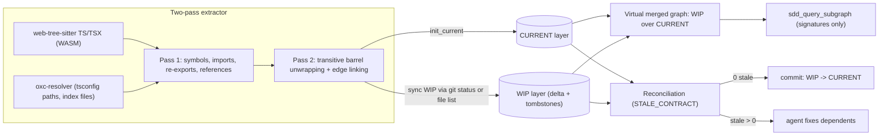
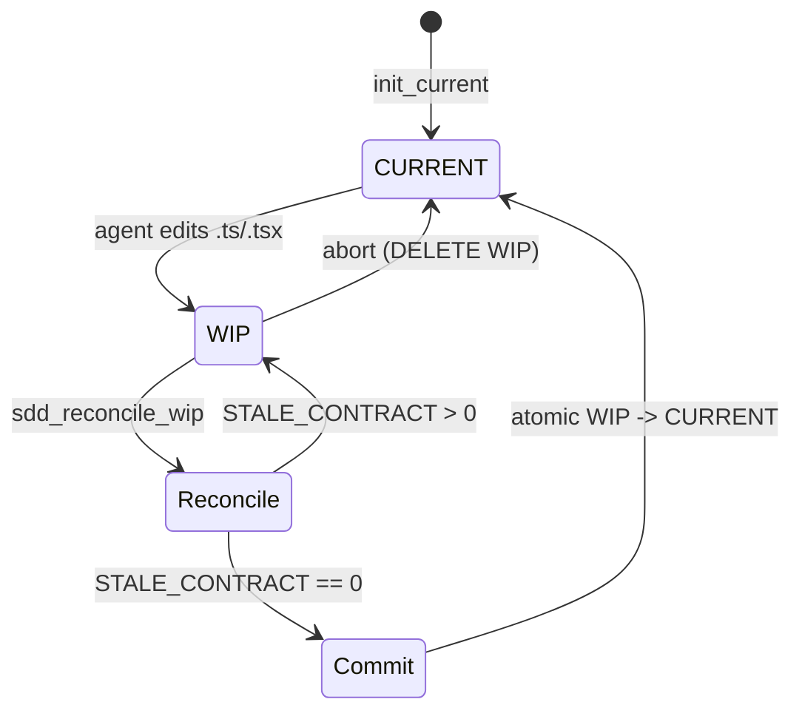

# sdd-graph-mcp

A local MCP server that keeps a **two-layer, copy-on-write code-contract graph** for TypeScript/React repositories and uses it to catch contracts broken by multi-step agentic edits.

The graph lives in the built-in `node:sqlite`. It has an immutable baseline layer (`CURRENT`) and a task-scoped delta layer (`WIP`), the same idea as React Fiber's `current` / `workInProgress` trees. A deterministic SQL *reconciliation* pass diffs the two layers and returns every dependent symbol that still targets an old contract (`STALE_CONTRACT`). For each one you get the call-site line and the old/new signatures. On `bulletproof-react` this pass runs in under a millisecond.

> **Status: v0.1, research prototype.** TS/TSX only, purely syntactic (no type checker). See [Architectural Trade-offs & Known Limitations](#architectural-trade-offs--known-limitations) before you depend on it.

Design background, SQL derivations, and the survey of prior work behind this engine are in [docs/RESEARCH_REPORT_2026.md](docs/RESEARCH_REPORT_2026.md) (covering LocAgent ACL'25, RepoGraph ICLR'25, CodexGraph NAACL'25, InlineCoder FSE'26, ARISE'26, SeeRepo ASE'26, Rivet'26, and the 2026 MCP code-graph servers).

---

## Table of Contents

1. [Motivation: The Baseline Amnesia Problem](#motivation-the-baseline-amnesia-problem)
2. [Core Architecture](#core-architecture)
3. [MCP Tool Surface](#mcp-tool-surface)
4. [Comparison with the 2026 Code-Graph Ecosystem](#comparison-with-the-2026-code-graph-ecosystem)
5. [Real-World Benchmarks (`bulletproof-react`)](#real-world-benchmarks-bulletproof-react)
6. [Architectural Trade-offs & Known Limitations](#architectural-trade-offs--known-limitations)
7. [Roadmap (v0.2)](#roadmap-v02)
8. [Quickstart & Reproducing Benchmarks](#quickstart--reproducing-benchmarks)

---

## Motivation: The Baseline Amnesia Problem

Current MCP code-graph servers keep **one** graph and update it **in place**. A file watcher re-parses a saved file and overwrites that file's nodes and edges. That works for "chat with your codebase". It breaks for Spec-Driven Development (SDD), where an agent carries out a multi-file change against a written spec:

| Failure mode | What happens with a single in-place graph |
| :--- | :--- |
| **Baseline amnesia** | When the agent changes `verifyToken(token)` to `verifyToken(token, opts)`, the old signature is overwritten. The graph can no longer tell which of the 12 callers were written against `sig_v1` and which were already adapted to `sig_v2`. |
| **Torn reads** | Halfway through a 5-file refactor, the graph is a mix of new and old code. Broken edges look the same as the original topology. |
| **No rollback** | An abandoned hypothesis can only be undone by a full re-index. |
| **No commit gate** | Nothing stops the agent from declaring the task done while dependents still target the old contract. |

You can reconstruct the old signatures from `git show HEAD:file`. But the SDD task boundary is not the git commit boundary: an agent may edit for dozens of steps without committing, or commit midway. `sdd-graph-mcp` makes the task baseline an explicit, queryable layer. It does not rely on version control to provide it.

---

## Core Architecture



### 1. Two-layer copy-on-write store on `node:sqlite`

- Three tables: `nodes`, `edges`, `specs`. All are `WITHOUT ROWID` and clustered on a composite primary key ending in `layer IN ('CURRENT','WIP')`, for example `PRIMARY KEY (node_id, layer)`.
- `CURRENT` is read-only for the duration of a task. All mutations go to `WIP`. A deletion is written as a `WIP` row with `is_tombstone = 1`, and `CURRENT` is left untouched.
- Every read resolves through a single overlay rule. For each `LEFT JOIN` pair `w` (`WIP`) and `c` (`CURRENT`):

  ```sql
  WHERE COALESCE(w.is_tombstone, c.is_tombstone, 1) = 0
  ```

  The rule returns the `WIP` row if one exists and is live. It hides the symbol if `WIP` tombstoned it. It falls back to `CURRENT` otherwise, and treats IDs that exist in neither layer as absent.
- **Commit** runs in one `BEGIN IMMEDIATE` transaction. It applies tombstones, promotes live `WIP` rows, removes orphaned edges and clears `WIP`. **Abort** is three `DELETE ... WHERE layer = 'WIP'` statements.
- There are no native build steps: storage is `node:sqlite` (`DatabaseSync`, WAL), the parser is WASM, and the resolver ships as a prebuilt Rust N-API binary (`oxc-resolver`).

### 2. `signature_hash` (contract) vs `body_hash` (implementation)

Each callable is stored with two hashes. Both are computed over source with comments stripped by AST byte range and whitespace collapsed:

| Hash | Covers | Effect when changed |
| :--- | :--- | :--- |
| `signature_hash` | Everything up to the body: modifiers, generics, parameters, return annotation. For `interface` and `type` declarations, the full declaration. | Triggers reconciliation for dependents |
| `body_hash` | The function body / JSX | Ignored by reconciliation; 0 false `STALE_CONTRACT` |

Each dependency edge stores `expected_target_hash`: the target's `signature_hash` at the time the edge was extracted. Node IDs are canonical: `src/components/ui/button/button.tsx::Button#component`.

For callables, `signature_hash` is a **contract hash**, not a hash of the raw signature text. Parameter binding patterns and default values are cut out by AST range before hashing, because TypeScript parameters are positional. Whitespace around punctuation and Prettier trailing commas are normalized away. As a result, the following do **not** change the contract:
- parameter renames;
- destructuring changes (`({ a }: Props)` → `({ a, b, ...rest }: Props)`);
- default values;
- reformatting.

Parameter types, arity, optionality, return type, `async`, and wrapper generics (`forwardRef<HTMLButtonElement, ButtonProps>`) still do. The human-readable `signature` column keeps the original text.

### 3. Two-pass AST extraction with barrel unwrapping

- **Pass 1** (per file, `web-tree-sitter`): top-level `function`, arrow/function-expression `const`s (including `memo(...)` / `forwardRef(...)` wrappers around inline functions), `interface`, and `type`. For each it records:
  - imports and re-exports;
  - references inside each declaration: `CALLS` (`call_expression`), `RENDERS_JSX` (`jsx_opening_element` / `jsx_self_closing_element`), and `USES_TYPE` (`type_identifier`).
- **Pass 2** (project): each import is resolved through `oxc-resolver` (tsconfig `paths`/`baseUrl`, index files, extension aliases). It is then followed through any chain of `export *` / `export { a as b } from` re-exports to the defining symbol. A visited set keyed on `(file, exportedName)` makes cyclic barrels (`A -> B -> A`) terminate. Edges that were resolved through at least one barrel are tagged `resolution_mode = 'BARREL_UNWRAPPED'`.
- **Incremental sync** re-parses only changed files into `WIP`. Unchanged files are resolved against the effective (`WIP` over `CURRENT`) node map loaded from SQLite.
  - Changed files are discovered with `git status --porcelain -- .` and re-based from the git top-level (`git rev-parse --show-toplevel`) onto `projectRoot`. A monorepo sub-package such as `apps/web` therefore works as a project root, and changes in sibling packages are ignored.
- **WASM memory:** each Tree-sitter tree is freed with `tree.delete()` in a `finally` block. The WASM heap is not managed by the JS garbage collector.

### 4. Hub damping

Utilities such as `cn()` have dozens to hundreds of callers. A naive bidirectional k-hop query from `Button` reaches `cn` at hop 1 (outbound). At hop 2 it then pulls in every unrelated component that also calls `cn`.

`querySubgraph` blocks **inbound** expansion from a node that was reached via an **outbound** edge at hop ≥ 1 when that node's distinct in-degree exceeds `maxHubInDegree` (default 20). The hub is still returned. Its co-dependents are not. Direct callers of the seed (hop 1 inbound) are never damped.

The hub test is a correlated subquery that runs once per candidate edge. Its distinct count is therefore bounded with `LIMIT maxHubInDegree + 1`, so each check costs O(min(in-degree, threshold)) instead of O(in-degree). This avoids O(in-degree²) behaviour on large hubs: a 5,000-caller hub is damped in about 13 ms, versus 2.4 s with an unbounded `COUNT(DISTINCT)`.

### 5. Reconciliation: deterministic `STALE_CONTRACT` detection

A recursive CTE starts from the (small) `WIP` layer:

- **d = 1** (`DIRECT_SIGNATURE_MUTATION` / `TOMBSTONED_TARGET`): `U` is stale when all of the following hold:
  - target `T` changed its `signature_hash` in `WIP` or was tombstoned;
  - the `CALLS | USES_TYPE | RENDERS_JSX` edge `U -> T` is still live;
  - `U` has not been adapted. That means one of:
    - `U` is not in `WIP` at all;
    - `U` is in `WIP` only because its file was re-parsed, with unchanged `body_hash` **and** `signature_hash`;
    - `U`'s edge still carries the old `expected_target_hash`.
- **d = 2** (`TRANSITIVE_TYPE_CONTRACT_DRIFT`): drift propagates in two cases:
  - from a stale `interface`/`type` to its `USES_TYPE` dependents;
  - from a component that is stale through its props type (`USES_TYPE` at d = 1) to every parent that renders it (`RENDERS_JSX`): `ButtonProps -> Button (d=1) -> <Button/> call sites (d=2)`.

  Depth is capped at 3. Cycles are cut by a visit path.

Each report row contains: the stale node, file, broken line, dependency type, mutated target, old/new signature and old/new hash. Output order is deterministic (`propagation_depth, file, line`), which keeps the agent's prompt-cache prefix stable.



---

## MCP Tool Surface

There are four tools. The tool schema never changes at runtime: no dynamic enums or counters, so the tool list stays prompt-cache friendly. All output is sorted deterministically (`hop_distance, node_id`).

| Tool | Purpose |
| :--- | :--- |
| `sdd_query_subgraph` | k-hop (1..5) merged subgraph around a symbol. Returns **signatures + JSDoc + edge traces with call-site lines only**, never bodies. |
| `sdd_read_implementation` | Reads exact `start_line..end_line` source for selected nodes from disk, right before editing them. |
| `sdd_reconcile_wip` | Syncs changed files into `WIP` (explicit list or `git status`), runs reconciliation, and returns `commit_gate: PASSED \| BLOCKED_BY_STALE_CONTRACTS`. |
| `sdd_lifecycle` | `init_current` \| `status` \| `commit` (gated; `force` bypasses the gate) \| `abort`. |

---

## Comparison with the 2026 Code-Graph Ecosystem

These tools are broader and more mature than this project. The table only compares the axis this project is built around: **state over the lifetime of an editing task**. Descriptions of other tools are based on their public documentation as of November 2026.

| | Parsing & resolution | Storage | Update model | Pre-task baseline kept? | Contract-drift output |
| :--- | :--- | :--- | :--- | :--- | :--- |
| **`@colbymchenry/codegraph`** | Tree-sitter, many languages | SQLite + FTS5 | File watcher, incremental **in-place** sync | No (single layer) | Callers / impact of the *current* state |
| **Repowise** | Tree-sitter, multi-tier call resolution; PageRank, Leiden communities; git churn/co-change | SQLite + LanceDB (hybrid FTS/vector) | Re-index / incremental | No (single snapshot + git history analytics) | Change-risk / blast-radius scoring |
| **`codebase-memory-mcp`** | Native binary, 150+ Tree-sitter grammars + hybrid LSP-style type resolution for ~10 languages incl. TS | SQLite | Incremental; maps git diff onto graph | No (single layer) | Impact of a git diff |
| **Aider RepoMap** | Tree-sitter tags; file graph + personalized PageRank under a token budget | mtime-keyed tag cache | Recomputed per request | N/A (context selection, not a contract graph) | None |
| **sdd-graph-mcp** | Tree-sitter TS/TSX + `oxc-resolver` + barrel unwrapping; **no type checker** | `node:sqlite`, `CURRENT`/`WIP` CoW | Explicit sync into `WIP`, atomic commit/abort | **Yes** | `STALE_CONTRACT` with old/new signature, call-site line, d=1/d=2, commit gate |

**Where the others are stronger:**
- language coverage (one language vs 100+);
- type-aware resolution (hybrid LSP resolves member calls on inferred types, which this project does not);
- community detection and centrality ranking;
- semantic/vector search;
- git-history analytics;
- maturity and tooling.

**What this project adds:** the baseline is an explicit, queryable layer. It provides three things that a single in-place graph cannot express without re-parsing history:
- the **"which dependents have not been adapted yet"** relation;
- **consistent reads of the work-in-progress state**;
- **O(1) rollback**.

### Why not just use an existing graph, or `tsc`?

- **Why not run `tsc --noEmit`?** Keep running it. It is the ground truth and remains the final gate. Reconciliation is a cheap per-step pre-filter:
  - it returns a structured worklist (node, line, old/new signature) instead of compiler diagnostics;
  - it costs less than a millisecond instead of a type-check of the whole project;
  - it also flags dependents whose code *still compiles* against a changed contract (for example, a newly added optional parameter), which `tsc` cannot report.
- **Why not add a WIP layer to an existing tool?** Their schemas key nodes by a single `id`, and every query assumes one layer. Adding `layer`, tombstones and hash-pinned edges touches every query. The CoW store here is about 1,000 lines. The reusable part (Tree-sitter extraction) is the commodity part.

---

## Real-World Benchmarks (`bulletproof-react`)

Target: [`alan2207/bulletproof-react`](https://github.com/alan2207/bulletproof-react) @ `9506629`, all three apps, 415 `.ts/.tsx` files. Measured on an Apple Silicon laptop with Node.js 24.8.0 and an in-memory database; three runs.

| Metric | Result |
| :--- | :--- |
| Cold baseline index (`CURRENT`) | **300–400 ms** (≈1,000–1,370 files/s), parse + resolve + SQLite insert |
| Extracted graph | 830 nodes (component 324, type_alias 267, function 191, hook 48); 2,224 edges |
| Edges recovered through barrels (`BARREL_UNWRAPPED`) | **513 / 2,224 (23.1 %)**: IMPORTS 262, RENDERS_JSX 248, USES_TYPE 3. A resolver that stops at `index.ts` loses these edges. |
| 2-hop subgraph of `Button` (react-vite), no damping | 121 nodes / 65 files / 11.57 KB of signatures, ≈6 ms |
| Same, **hub damping** (`maxHubInDegree = 20`) | 98 nodes / 63 files / **8.75 KB**, ≈3.5–5 ms; 23 unrelated `cn()` co-callers removed |
| Context size vs. reading the same files raw | 8.75 KB vs 107.99 KB → **−91.9 %** (bytes, not tokens) |
| Reconciliation after mutating `ButtonProps` in `WIP` | **0.5–0.7 ms** (includes the `WIP` upsert); 27 `STALE_CONTRACT`: 2 at d=1 (`Button`, `PaginationLinkProps`), 25 at d=2 (`<Button/>` render sites such as `LandingRoute`, `DashboardLayout`, `ConfirmationDialog`) |
| Query plans | `SEARCH ... USING PRIMARY KEY` / covering index for every `nodes`/`edges` access (`SCAN` only over CTE rows) |

How to read these numbers:
- The d=2 result over-approximates. It flags every `<Button/>` site for *any* `ButtonProps` change, including additive optional props (see limitations).
- The context-reduction figure compares against the raw files that contain the subgraph's nodes, not against a whole-repo dump.

---

## Architectural Trade-offs & Known Limitations

Each limitation below is either an explicit design choice or a known gap. Items marked *(planned)* have a scoped fix in the roadmap.

### Precision and recall of contracts (no type checker)

- **Inferred contracts are invisible.** A hook with no return annotation changes its real contract through its body, but only `body_hash` changes. The same applies to `z.infer<typeof schema>`, `ReturnType<...>`, and generic inference. All of these need a TypeChecker. *(planned: on-demand checker for `WIP` nodes)*
- **Hash equality, not compatibility.** Adding an optional prop is reported exactly like adding a required one. There is no variance or structural diff.
- **Acknowledgement is node-level, not call-site-level.** A caller counts as adapted when its own `body_hash` or `signature_hash` changed in `WIP`. Re-parsing an untouched caller does **not** clear it; a regression test covers this. Editing an unrelated line *inside the same function* does clear it. *(planned: per-edge `call_site_hash`)*
- **`commit` with `force: true` makes drift invisible.** After promotion, reconciliation only diffs `WIP` against `CURRENT`. The mismatch survives in `CURRENT.expected_target_hash`, but nothing checks it yet. *(planned: latent-drift integrity query)*

### Extractor coverage (TS/TSX)

Not extracted as nodes:
- `class` and `enum` declarations;
- non-function `const`s: zod schemas, `cva` variants, config objects. In `bulletproof-react` this is roughly 134 of 432 exported `const`s;
- `memo(Identifier)` / `forwardRef(Identifier)` wrapping a named function;
- anonymous `export default`;
- overload signatures (only the implementation signature is hashed).

Not resolved as edges:
- `export * as NS from`;
- compound components assigned via `Object.assign` (`<Form.Item />` through a named import; `import * as F` works);
- 3-level JSX namespaces;
- `lazy(() => import(...))`;
- member calls on values (`api.get()`).

Other gaps:
- **Unresolved references are dropped silently.** There is no `UNRESOLVED` diagnostic, so a missing edge is indistinguishable from no dependency.
- The schema reserves `EXTENDS`, `PASSES_PROPS`, `IMPLEMENTS_SPEC`, `VERIFIED_BY_TEST` and the `class` / `method` / `variable` / `module` kinds. v0.1 emits only `IMPORTS`, `CALLS`, `RENDERS_JSX`, `USES_TYPE` and five node kinds. `extends` clauses are captured as `USES_TYPE`.
- Only `.ts` / `.tsx`; `.d.ts` is skipped.

### Performance and operations

- `WIP` discovery is relative to git `HEAD`, not to `CURRENT`. Files committed into `CURRENT` but not into git are re-synced on every call. This is idempotent but wasteful.
- No staleness check between a persisted `CURRENT` and the files on disk after a restart. Run `init_current` if in doubt.
- Commit-time orphan cleanup is a full scan of `CURRENT` edges (O(E)).
- `web-tree-sitter` is pinned to 0.20.x.

---

## Roadmap (v0.2)

1. **`SPEC_DRIFT`.** Parse `.md` specs into `specs` (heading anchors → `spec_id`, `content_hash`). Link code via `@spec path.md#anchor` JSDoc tags (`IMPLEMENTS_SPEC`). Report nodes whose spec section changed in `WIP` while the code did not, using the same CTE pattern as `STALE_CONTRACT`.
2. **Per-edge `call_site_hash`** (normalized call expression / JSX opening element) for call-site-level acknowledgement.
3. **Latent-drift integrity check** on `CURRENT` (`expected_target_hash != target.signature_hash`), surfaced in `status` and after `force` commits.
4. **`UNRESOLVED_REFERENCE` diagnostics** for references that resolve to no symbol.
5. **On-demand TypeScript checker** (`LSP_TYPECHECKER` resolution mode), limited to unresolved member calls and unannotated return types of `WIP` nodes.
6. **Extractor coverage:** `enum`, `class`/`method`, schema `const`s, `memo(Ident)`, `export * as NS`, compound components.

---

## Quickstart & Reproducing Benchmarks

**Requirements:** Node.js with built-in `node:sqlite` and native TypeScript type stripping. Tested on **Node 24.8.0**; Node ≥ 22.18 should work. No build step: sources run as `.ts` directly.

```bash
npm install
npm test                      # node:test, 21 tests (store, extractor, indexer, MCP e2e)
```

**Benchmarks:**

```bash
# Synthetic TS/React repo (offline)
npm run bench -- --synthetic 200

# bulletproof-react (shallow clone into a temp dir, removed afterwards)
npm run bench -- --clone https://github.com/alan2207/bulletproof-react.git

# Any local checkout
npm run bench -- --repo /path/to/project
```

The benchmark prints the following, in order:
1. cold-index statistics with the edge breakdown by `resolution_mode`;
2. the damped vs. undamped 2-hop subgraph around `Button`, with `EXPLAIN QUERY PLAN`;
3. the d=1 / d=2 reconciliation report after mutating `ButtonProps` in `WIP`.

**MCP client configuration** (Claude Code / Cursor / Antigravity):

```json
{
  "mcpServers": {
    "sdd-graph": {
      "command": "node",
      "args": [
        "--no-warnings",
        "/abs/path/to/sdd-graph-mcp/src/index.ts",
        "--project-root", "/abs/path/to/your/repo",
        "--init-current"
      ]
    }
  }
}
```

Options:

| Flag | Default |
| :--- | :--- |
| `--db-path <file>` | `.sdd-graph/sdd-graph.db` |
| `--memory` | in-memory database |
| `--init-current` | index `CURRENT` on startup |

The same settings are available as env vars: `SDD_PROJECT_ROOT`, `SDD_DB_PATH`, `SDD_AUTO_INIT=1`.

**Typical agent loop:**

1. `sdd_lifecycle(init_current)`.
2. `sdd_query_subgraph` → `sdd_read_implementation` → edit.
3. `sdd_reconcile_wip`, then fix each reported `STALE_CONTRACT`.
4. Repeat steps 2–3 until `commit_gate = PASSED`.
5. Run `tsc --noEmit` and the tests.
6. `sdd_lifecycle(commit)`.
